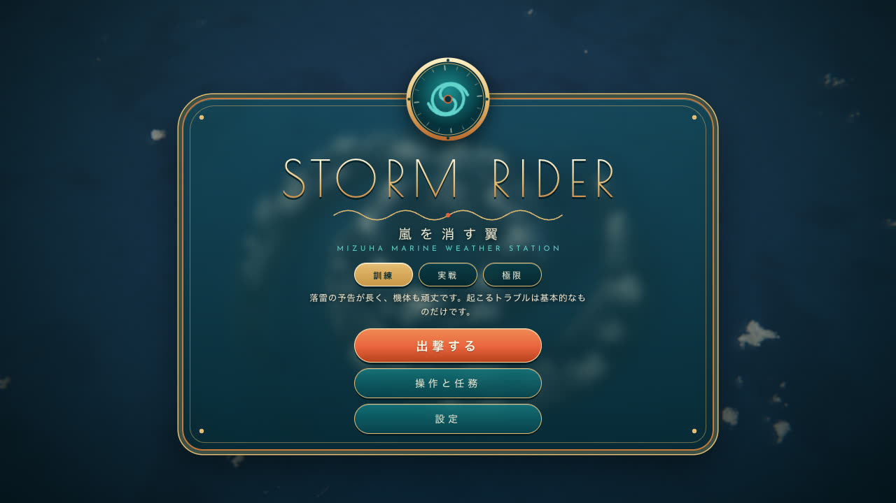
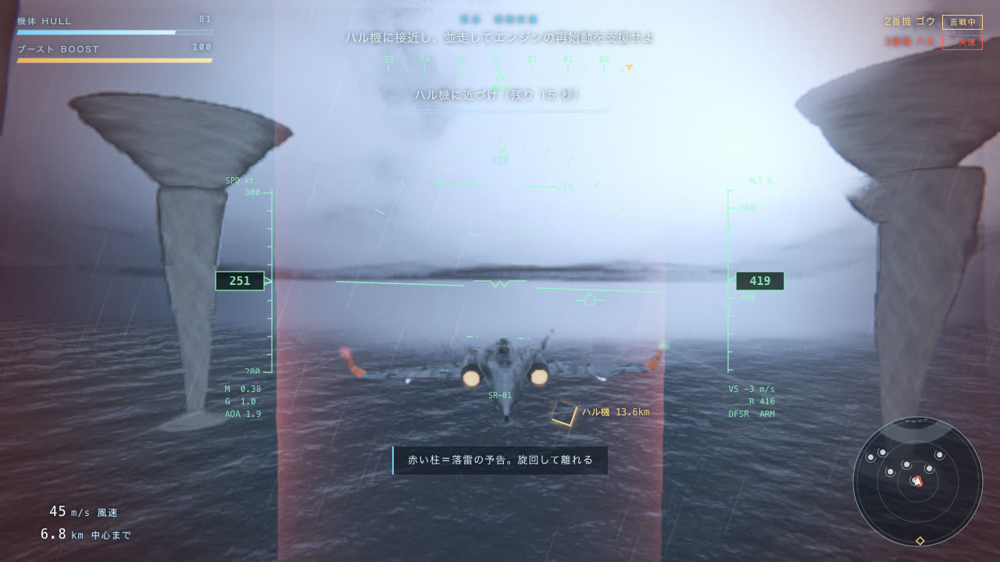
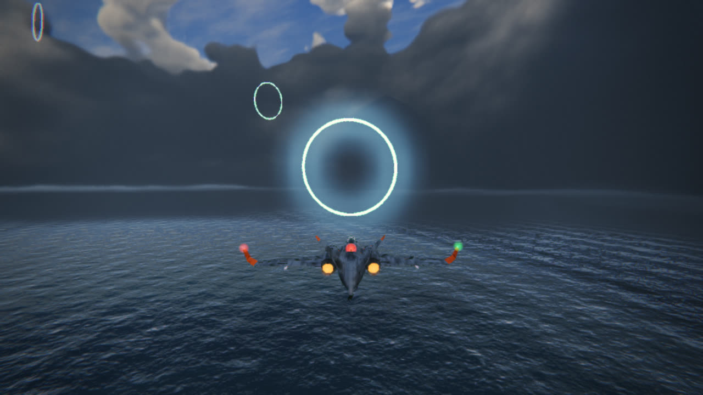
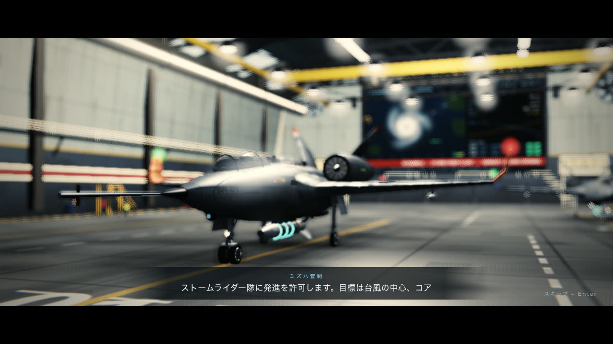
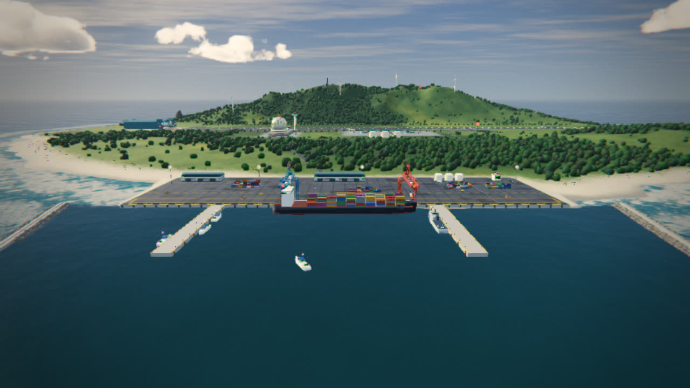
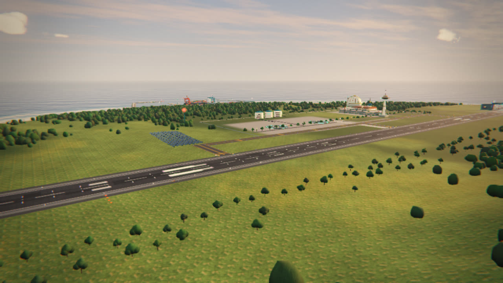
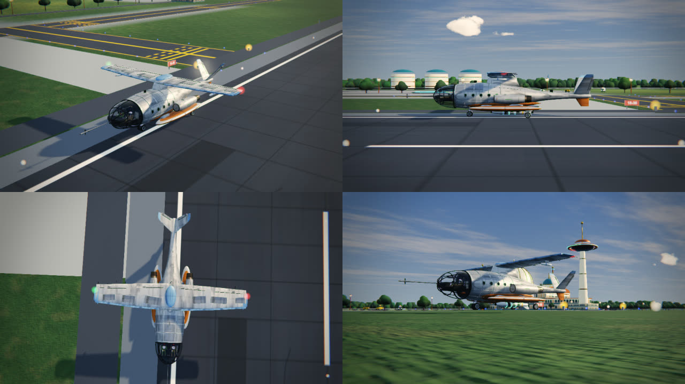

# STORM RIDER — 嵐を消す翼

観測史上最大の台風に、特殊気象観測機の編隊で突入し、中心の「コア」へディフューザーを撃ち込んで嵐を消す。
ブラウザだけで遊べる 3D フライトアクションです。インストールもアカウントも要りません。



| | |
|---|---|
|  |  |
|  |  |
|  |  |

## すぐ遊ぶ

### ▶ [ここを開くだけで遊べます](https://moriken2004.github.io/Storm_Rider_Game/)

**https://moriken2004.github.io/Storm_Rider_Game/**

ダウンロードもインストールも要りません。PC のブラウザで開いて「出撃する」を押してください（スマートフォンでも動きますが、PC のほうが快適です）。

### 手元に置いて遊ぶ

ネットにつながない場所で遊びたいときや、中身を書き換えたいときは、**`index.html` をブラウザで開くだけ**です。

1. このページ右上の緑のボタン **Code → Download ZIP** を押し、ZIP を展開します。
2. 展開したフォルダの `index.html` をダブルクリックします。
3. 「出撃する」を押します。

Chrome・Edge・Safari・Firefox の新しめの版で動きます（WebGL 2 が必要）。初回だけ、描画ライブラリと書体を読み込むためにインターネット接続が要ります。

うまく動かないときや、ほかの起動方法（ローカルサーバー、GitHub Pages での公開）は [docs/SETUP.md](docs/SETUP.md) を見てください。

## 操作

| キー | 動作 |
|---|---|
| `W` `S` / `↑` `↓` | 機首の上げ下げ |
| `A` `D` / `←` `→` | 旋回 |
| `Shift` | ブースト（ゲージを消費） |
| `Q` `E` / `A` `D` の 2 度押し | バレルロール（近いミサイルを振り切れることがある） |
| `Space` | ディフューザー発射・各種の操作（消火、再始動など） |
| `Esc` / `P` | 一時停止 |
| `Enter` | カットシーンを飛ばす |

スマートフォンやタブレットでは、端末を横向きにして遊びます。画面の左側に指を置いて動かすと操縦、右下の「ブースト」「発射」「ロール」、右上の「Ⅱ」で一時停止です。上下の反転、音量、画質、機体の形と塗装は「設定」から変えられます。

## 任務の流れ

1. **出撃** — ミズハ海洋気象基地の格納庫から離陸します。
2. **PHASE 1 レインバンド** — 赤い光の柱（落雷の予告）を避けながら中心へ。
3. **PHASE 2 壁雲** — 視界ゼロの暴風の壁を、マーカーだけを頼りに突き抜けます。
4. **PHASE 3 台風の目** — 観測リングを通ってコアの座標を確定し、ロックオンして発射。
5. **PHASE 4 再攻撃** — 1 発目は落雷で失われます。2 番機から予備を空中で受け取り、今度は至近から。
6. **PHASE 5 帰投** — 進入ゲートを通って滑走路へ。

途中で 3 番機ハルが失速します。そばを並んで飛べば、再始動を助けられます。

くわしい攻略、難易度ごとの違い、ランクの決まり方は [docs/GAMEPLAY.md](docs/GAMEPLAY.md) にあります。

## 特徴

- **体積雲の台風** — 半径 15km の台風を、雲の濃さを視線に沿って積み上げる方法で描いています。目・壁雲・レインバンドの構造があり、中を飛べます。
- **7 種の機体 × 7 色の塗装** — 後退翼、デルタ翼、前進翼、全翼機、結合翼、逆ガル翼、原型機。操縦席には操縦士が乗り、被弾すると装甲板が剥がれて骨組みがのぞきます。
- **3 段階の難易度** — 訓練・実戦・極限。難しくなるほど、着氷、計器故障、風向の急変、脚の油圧故障、雹、エンジン火災が加わります。
- **作り込んだ母基地** — 格納庫、滑走路と誘導路、管制塔、灯台、港、風車。建物や柱には当たり判定があり、主翼を柱にぶつけると翼がもげます。
- **音もすべて合成** — 音楽、雷、エンジン、風雨はどれも WebAudio でその場で合成しています。音声ファイルは 1 つも入っていません。
- **好きな曲を BGM に** — 手元の音楽ファイルを 1 行のコマンドで取り込めます。曲を解析して、場面ごとの繰り返し区間を自動で決めます（[bgm/README.md](bgm/README.md)）。

## 中身を知りたい人へ

| 文書 | 内容 |
|---|---|
| [docs/SETUP.md](docs/SETUP.md) | 起動方法の詳細、困ったとき |
| [bgm/README.md](bgm/README.md) | 好きな音楽を BGM にする方法 |
| [docs/GAMEPLAY.md](docs/GAMEPLAY.md) | 攻略、トラブルの対処、難易度、ランク |
| [docs/ARCHITECTURE.md](docs/ARCHITECTURE.md) | 描画・音・ゲーム進行の仕組みの解説 |
| [docs/DEVELOPMENT.md](docs/DEVELOPMENT.md) | ソースの構成、ビルド、検査用の道具、予告編の作り方 |

## フォルダの構成

```
index.html      遊ぶためのファイル（src/ から自動生成。これ 1 枚で動く）
src/            ソース（head.html, core.js, world.js, audio.js, game.js）
build.mjs       src/ を index.html にまとめる
serve.mjs       開発用の簡易サーバー
test/           自動操縦の通しプレイ、部品の干渉検査、描画の点検など
trailer/        予告編を 1 コマずつ撮る仕組み
bgm/            手元の音楽を BGM にするスクリプト（音源そのものは入っていません）
docs/           文書と画面写真
```

## 権利と注意

- プログラムと文書は [MIT ライセンス](LICENSE)です。
- 描画には [three.js](https://threejs.org/) r128（MIT）を、書体には Google Fonts の Poiret One と Josefin Sans（SIL OFL）を、どちらも配信サービスから読み込んで使っています。
- これは個人が作った非公式の作品です。実在の施設・企業・団体とは関係がなく、その承認も受けていません。
- 音楽ファイルや、既存の楽曲を使った映像は、このリポジトリに含めていません。
